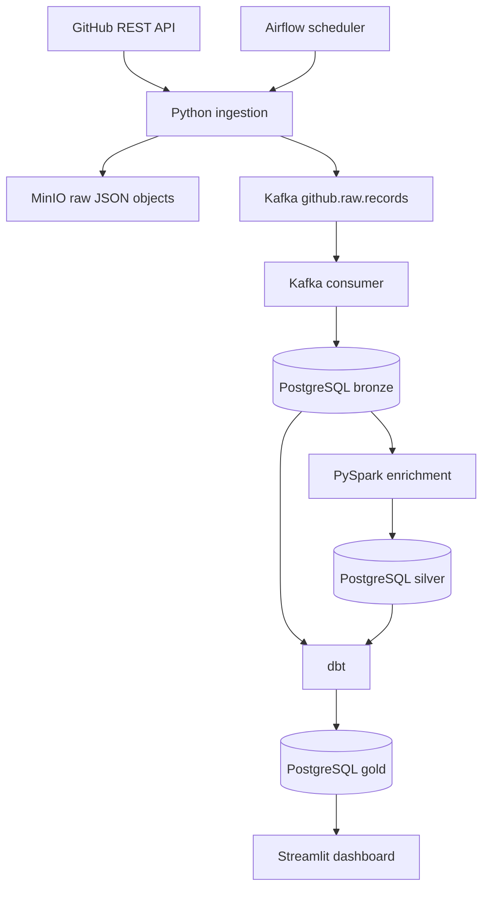

# DevPulse — GitHub Engineering Analytics Platform

A local, Docker-based data platform that collects engineering activity from seven public
GitHub repositories, stores raw payloads in MinIO and PostgreSQL, transports records through
Kafka, enriches data with PySpark, models analytics with dbt, schedules ingestion with
Airflow, and presents metrics in Streamlit.

## Repositories monitored

- `adithyamogili/mailmon-backend`
- `adithyamogili/mailmon-frontend`
- `adithyamogili/Metatconvo`
- `adithyamogili/olist-data-engineering`
- `fastapi/fastapi`
- `django/django`
- `apache/airflow`

Edit `GITHUB_REPOSITORIES` in `.env` to change this list.

## Architecture and data flow



Airflow schedules the batch ingestion command. The ingestion process writes each API record
to MinIO and publishes it to Kafka. The Kafka consumer persists messages into PostgreSQL
Bronze. The Spark job reads Bronze and writes a Silver enrichment table. dbt builds
analytics models in Gold. Streamlit reads the Gold marts.

## Requirements

- Windows 10/11 with Docker Desktop using Linux containers / WSL2
- Python 3.12 recommended for local tests and helper scripts
- At least 8 GB RAM recommended; 12–16 GB is more comfortable for the full stack
- Internet access to `api.github.com` and Docker image registries

No GitHub token is required for public repositories. GitHub unauthenticated API limits apply.
A token can optionally be added to `.env` as `GITHUB_TOKEN`; use read-only access and never
commit `.env`.

## One-time setup (Windows PowerShell)

1. Extract the ZIP to a short path, for example `C:\Projects\devpulse`.
2. Open that folder in VS Code.
3. Copy `.env.example` to `.env`:
   ```powershell
   Copy-Item .env.example .env
   ```
4. (Optional but recommended) Create a local Python environment for running tests:
   ```powershell
   py -3.12 -m venv .venv
   .\.venv\Scripts\Activate.ps1
   python -m pip install --upgrade pip
   pip install -r requirements-dev.txt
   ```
   If PowerShell blocks activation, run:
   `Set-ExecutionPolicy -Scope Process -ExecutionPolicy Bypass`
   then activate again.
5. Start the platform:
   ```powershell
   docker compose up -d --build
   ```
   First startup downloads several large images and can take a while.
6. Check services:
   ```powershell
   docker compose ps
   docker compose logs -f airflow-scheduler
   ```

## Service URLs and local credentials

| Service | URL / port | Local development credentials |
|---|---|---|
| Streamlit dashboard | http://localhost:8501 | none |
| Airflow | http://localhost:8080 | `airflow` / `airflow` |
| MinIO console | http://localhost:9001 | `minioadmin` / `minioadmin` |
| PostgreSQL | localhost:5432 | `devpulse` / `devpulse` |
| Kafka | localhost:9092 | no auth (local only) |

These are intentionally simple local-development credentials. Do not expose this stack publicly.

## Run the first ingestion

After `docker compose ps` shows Kafka, MinIO and PostgreSQL healthy:

```powershell
docker compose run --rm app python -m devpulse.cli ingest --max-pages 1
```

This starts with one page per GitHub collection for each repository. It is a bounded initial
sample, not a complete historical backfill. To test a single repository:

```powershell
docker compose run --rm app python -m devpulse.cli ingest --repo fastapi/fastapi --max-pages 1
```

The ingestion process stores JSON objects in MinIO and publishes records to Kafka. The
`kafka-consumer` service consumes the topic and writes the records into
`bronze.github_api_records`. Check progress:

```powershell
docker compose logs -f kafka-consumer
```

## Build analytics

Run Spark enrichment after Bronze has records:

```powershell
docker compose run --rm spark-submit
```

Run dbt models and tests:

```powershell
docker compose run --rm dbt
```

Open the Streamlit dashboard at http://localhost:8501 after Gold models are built.

## Airflow orchestration

Open http://localhost:8080 and sign in with `airflow` / `airflow`.
Enable the `devpulse_github_ingestion` DAG. It runs a scheduled daily extraction. The DAG
runs ingestion; run Spark and dbt commands as shown above for the first local walkthrough.
The DAG and CLI are designed to be extended to chain all stages.

## Tests

Unit tests do not require Docker or network access:

```powershell
pytest
```

## Useful commands

```powershell
docker compose ps
docker compose logs -f app
docker compose logs -f kafka-consumer
docker compose down
```

To remove containers AND all local database/object-store data:
`docker compose down -v`
This is destructive. Do not run it unless you intentionally want to reset DevPulse.

## Project structure

- `devpulse/` GitHub API client, ingestion, Kafka producer/consumer, MinIO and database code
- `airflow/dags/` Airflow orchestration
- `spark/jobs/` PySpark Bronze-to-Silver enrichment
- `dbt/` staging and Gold analytics models plus tests
- `dashboard/` Streamlit analytics UI
- `sql/init/` PostgreSQL schemas and tables
- `tests/` offline unit tests
- `.github/workflows/` CI workflow

## Honest implementation notes

- GitHub public REST endpoints are used; no webhook receiver is included in this baseline.
- The first extraction is intentionally bounded by `--max-pages`; it is not a complete history.
- Kafka and MinIO are implemented as local services. This Compose stack is for development, not
  production deployment or high availability.
- Spark uses the PostgreSQL JDBC driver via `--packages`, which requires network access on first run.
- Airflow uses its official image with the project dependencies installed at build time.
- dbt models and dashboard queries require data to have been ingested and transformed first.
- GitHub rate limits, secondary limits, deleted/private repositories, and API schema changes
  can affect a run. The client retries transient failures and reports API errors.
